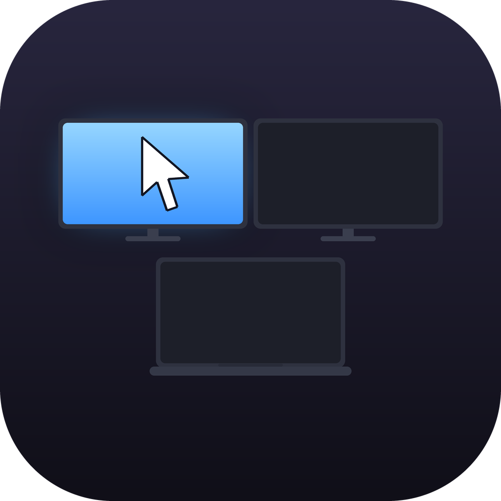
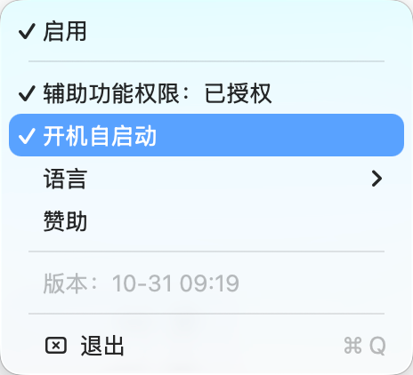

# FocusFlow

[简体中文](README.md) · [繁體中文](README.zh-Hant.md) · [English](README.en.md) · [日本語](README.ja.md) · [한국어](README.ko.md) · [Deutsch](README.de.md) · [Français](README.fr.md) · [Español](README.es.md) · [Italiano](README.it.md) · [Português](README.pt.md) · [Русский](README.ru.md) · [Tiếng Việt](README.vi.md)

**Move your mouse to another display — the window you last used there comes back to the front.**

## Why

On macOS, multi-display focus is click-driven: your cursor can be on display B while your keystrokes still go to a window on display A.

FocusFlow thinks per display, not per window: when the cursor crosses to another display, it brings back the window you last used on that display. Moving the mouse within one display does nothing, so you never switch windows by accident.

## Features

- **Cross-display activation**: remembers the last window per display and restores it
- **Menu bar icon matches your real layout**: drawn from your actual display arrangement, current display highlighted
- **12 languages**: switch in the menu, follows the system by default
- **Launch at login**
- **Lightweight**: zero wakeups while the mouse is idle

## Install

1. Download the DMG from [Releases](https://github.com/to-explore-future/focusflow/releases)
2. Drag FocusFlow into Applications
3. First launch: right-click → **Open** (not notarized, macOS warns once)
4. Grant **Accessibility** permission when asked

Requires macOS 12 or later.

## FAQ

**macOS blocked the first launch.**
It isn't notarized. Right-click → Open, once.

**Why does it need Accessibility?**
Raising windows of other apps requires it — there is no other way.

**How many displays are supported?**
Any number. The menu bar icon is drawn from your actual arrangement.

## Support

Free software. Tips are optional. If it helps you, that's all the reward I need.

Scan with WeChat. Any amount, entirely optional.
